  <!-- 🌊🇹🇷 Name + waving flag (single banner) -->
  

  <h2>🌊 Ocean of Code | Aspiring AI Engineer & Tech Enthusiast 💻</h2>

  

    
  

  <!-- Status Badges -->
  

    
    
    
  

 

---

### 🔱 About Me

> *"Like the ocean, code is deep, dynamic, and ever-changing. Every great journey starts with a single wave."*

Hello and welcome to my profile! I am **ARSLAN**. 

Although I am at the beginning of my programming journey and don't have extensive experience yet, I am a highly motivated, optimistic learner who works persistently every single day. My ultimate goal is to become a skilled and professional **AI Engineer**. Keep an eye on my journey—great things are coming!

- 🎯 **Target:** Becoming a professional AI Engineer through consistent daily learning.
- ⚓ **Current Focus:** Python, Mathematics
